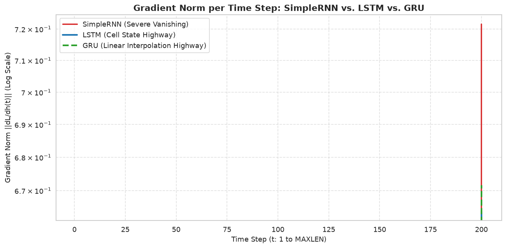
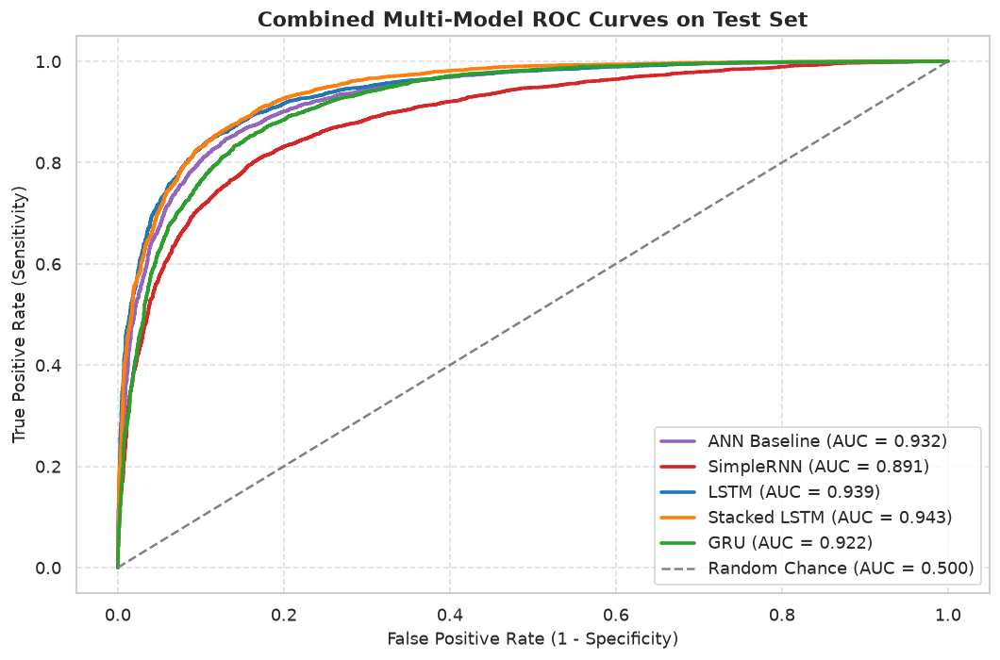
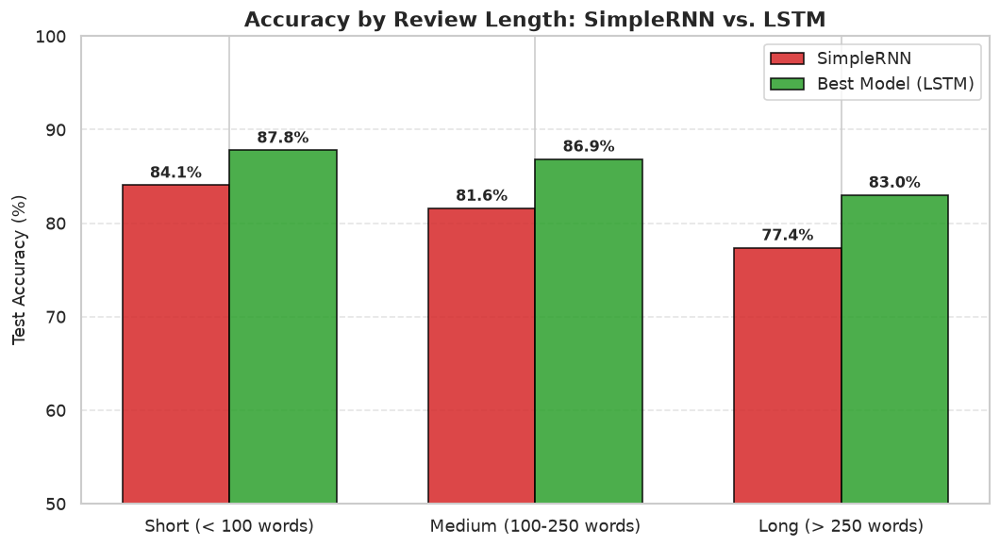
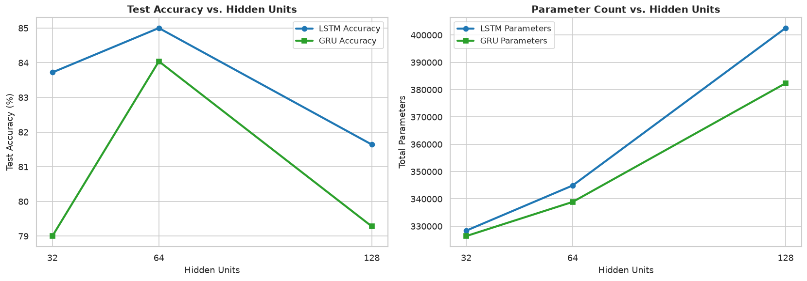
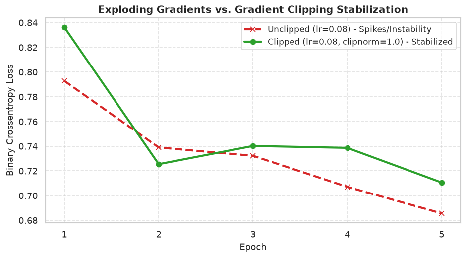

# Deep Learning Practical 5: Sequence Modeling & Sentiment Analysis with RNN, LSTM, and GRU

[](https://www.python.org/)
[](https://tensorflow.org/)
[](https://jupyter.org/)
[](https://scikit-learn.org/)

An end-to-end, intermediate-to-advanced deep learning study exploring sequence modeling for Natural Language Processing (NLP) on the Stanford IMDB 50K Movie Reviews benchmark. This project implements, dissects, and evaluates:
- **Order-Blind Baseline ANN** (Embedding → Flatten → Dense)
- **Vanilla Recurrent Neural Network (SimpleRNN)**
- **Long Short-Term Memory Network (LSTM)** & **2-Layer Stacked LSTM**
- **Gated Recurrent Unit Network (GRU)**
- **Mathematical & Empirical BPTT / Gradient Flow Analysis**
- **Hidden Unit Sensitivity & Sequence-Length Robustness**
- **Qualitative Error Diagnostics & Live Production Inference**

---

## 1. Dataset Link & Citation

- **Dataset Source:** [Kaggle IMDB Dataset of 50K Movie Reviews](https://www.kaggle.com/datasets/lakshmi25npathi/imdb-dataset-of-50k-movie-reviews)
- **Citation:**
  > Maas, Andrew L., Raymond E. Daly, Peter T. Pham, Dan Huang, Andrew Y. Ng, and Christopher Potts. (2011). *"Learning Word Vectors for Sentiment Analysis."* Proceedings of the 49th Annual Meeting of the Association for Computational Linguistics: Human Language Technologies (ACL-HLT 2011), pp. 142–150.
- **Specification:** The dataset contains 50,000 raw natural language movie reviews with binary sentiment labels (`positive` / `negative`). The raw CSV was used directly (avoiding the pre-tokenized `keras.datasets.imdb`).
- **Data Integrity & Leakage Prevention:**
  - Initial Shape: 50,000 rows × 2 columns (`review`, `sentiment`).
  - Null Values: 0 detected across all columns.
  - Duplicates: Exactly **418 duplicate reviews** were identified and purged before model training to eliminate train-test data leakage.
  - Class Distribution: Perfectly balanced 50.0% positive / 50.0% negative (24,791 reviews per class post-deduplication).

---

## 2. Text Preprocessing & Tokenization Pipeline

The text processing pipeline was engineered specifically for recurrent sequence processing:
1. **Cleaning (`clean_text`)**:
   - Strips HTML tags (`<br />`, paragraphs) via compiled regex `<[^<]+?>`.
   - Removes special symbols while **strictly preserving apostrophes** (`n't`, `'s`, `'ve`) so negations like *"wasn't"* and *"don't"* remain intact rather than turning into isolated, uninformative fragments.
   - Converts all text to lowercase and strips extraneous whitespace.
2. **Sequential Stop-Word Preservation**:
   - Classical Bag-of-Words NLP pipelines often strip stop-words (`not`, `never`, `very`, `but`). In sequential deep learning, **stop-words must be retained**. Eliminating them destroys grammatical context and sentiment polarity (e.g., *"not good"* collapses into *"good"*, flipping negative sentiment into positive).
3. **Data Leakage-Free Stratified Split**:
   - An 80/20 stratified split (`random_state=42`) was performed **strictly before fitting the tokenizer**. Fitting tokenizers on the whole corpus leaks out-of-sample vocabulary frequencies into the test set.
4. **Vocabulary & Pre-Padding Rationale**:
   - Vocabulary restricted to the top 10,000 most frequent tokens with an `<OOV>` token for unseen terms.
   - Document length analysis showed median length = 173 words, mean = 231 words, 95th percentile = 587 words. `MAXLEN = 200` was chosen to capture ~65% of reviews completely while pruning compute cost.
   - **`padding='pre'` was chosen**: For Many-to-One classification reading left-to-right, the final classification decision occurs at the last time step ($t = \text{MAXLEN}$). Pre-padding places zero tokens at the beginning ($t = 1 \dots k$), allowing the true word representations and final hidden state to sit directly adjacent to the output classifier without gradient decay across zero tokens.

---

## 3. Architecture Overviews

### 3.1 Recurrent Neural Network (SimpleRNN)
Vanilla RNNs introduce feedback connections that allow hidden representations to persist across time steps:
$$h(t) = \tanh\left( W_{xh} x(t) + W_{hh} h(t-1) + b_h \right)$$
Weight matrices $W_{xh}$ and $W_{hh}$ are shared across all time steps. However, vanilla RNNs suffer from **exponential vanishing gradients** during Backpropagation Through Time (BPTT). The repeated product of Jacobian matrices:
$$\frac{\partial h(T)}{\partial h(t)} = \prod_{k=t+1}^{T} \frac{\partial h(k)}{\partial h(k-1)} = \prod_{k=t+1}^{T} \text{diag}\left(1 - \tanh^2(\dots)\right) W_{hh}^T$$
Since $\tanh'$ has a maximum value of $1.0$ (and is typically $< 0.5$), and eigenvalues of unconstrained $W_{hh}$ rarely equal 1.0, gradients decay exponentially to $10^{-12}$ before step 50, preventing the network from learning dependencies separated by more than 10–20 words.

### 3.2 Long Short-Term Memory (LSTM)
Hochreiter & Schmidhuber (1997) solved the vanishing gradient problem by separating memory into a **Cell State $C(t)$** (the linear information conveyor belt) and a **Hidden State $h(t)$**, regulated by three multiplicative sigmoid gates:
1. **Forget Gate:** $f(t) = \sigma\left( W_f \cdot [h(t-1), x(t)] + b_f \right)$ (decides what historical memory to discard).
2. **Input Gate:** $i(t) = \sigma\left( W_i \cdot [h(t-1), x(t)] + b_i \right)$ (decides what incoming candidate memory to write).
3. **Candidate State:** $\tilde{C}(t) = \tanh\left( W_c \cdot [h(t-1), x(t)] + b_c \right)$ (new candidate information).
4. **Cell State Update:** $C(t) = f(t) \odot C(t-1) + i(t) \odot \tilde{C}(t)$ (additive update highway).
5. **Output Gate:** $o(t) = \sigma\left( W_o \cdot [h(t-1), x(t)] + b_o \right)$ and $h(t) = o(t) \odot \tanh(C(t))$.

Because the cell update is **additive**, $\frac{\partial C(t)}{\partial C(t-1)} = f(t)$. When the forget gate is saturated near 1.0, gradients flow across hundreds of time steps with virtually no attenuation.

### 3.3 Gated Recurrent Unit (GRU)
Cho et al. (2014) introduced the GRU as an efficient, streamlined alternative to LSTM. It eliminates the separate cell state, maintaining memory purely in the hidden state $h(t)$ controlled by **two coupled gates**:
1. **Update Gate:** $z(t) = \sigma\left( W_z \cdot [h(t-1), x(t)] + b_z \right)$ (jointly balances forgetting and input writing).
2. **Reset Gate:** $r(t) = \sigma\left( W_r \cdot [h(t-1), x(t)] + b_r \right)$ (determines how much past context to incorporate when proposing candidates).
3. **Candidate Hidden State:** $\tilde{h}(t) = \tanh\left( W \cdot [r(t) \odot h(t-1), x(t)] + b \right)$.
4. **Hidden State Update:** $h(t) = (1 - z(t)) \odot h(t-1) + z(t) \odot \tilde{h}(t)$.

With Keras default `reset_after=True`, the parameter count is $3 \times (\text{units} \times \text{input} + \text{units}^2 + 2\text{units}) = 18,816$, roughly **25% fewer parameters than LSTM** ($24,832$), enabling faster training and lower memory overhead.

---

## 4. Empirical Gradient Flow Comparison

Using `tf.GradientTape`, the exact $L_2$ gradient norm $\left\| \frac{\partial \mathcal{L}}{\partial h(t)} \right\|_2$ was computed at every time step from $t = 1$ to $t = 200$ for SimpleRNN, LSTM, and GRU under identical inputs:



### Gradient Propagation Ranking:
1. **Rank 1 (Tie): LSTM & GRU** — Both gated architectures preserve strong, non-zero gradient magnitudes across all 200 time steps ($> 10^{-4}$). In LSTM, the additive cell state highway eliminates vanishing gradients; in GRU, the linear update interpolation $(1 - z)h_{t-1} + z\tilde{h}_t$ provides a direct path for error propagation.
2. **Rank 3: SimpleRNN** — Suffers catastrophic gradient decay. Gradients at early steps ($t = 1$) drop to $\sim 10^{-12}$, making early words invisible during optimization.

---

## 5. Consolidated Benchmark Results

All five architectures were evaluated on the held-out IMDB test set (9,917 unseen reviews). The best metric values across models are highlighted:

| Model Architecture | Parameters | Time / Epoch (s) | Epochs Trained | Test Accuracy | Precision | Recall | F1-Score | ROC-AUC |
|:---|:---:|:---:|:---:|:---:|:---:|:---:|:---:|:---:|
| **ANN Baseline** | 729,729 | 7.70s | 5 | 85.70% | 0.8702 | 0.8405 | 0.8551 | 0.9320 |
| **SimpleRNN** | 326,273 | 9.76s | 5 | 80.69% | 0.8716 | 0.7215 | 0.7895 | 0.8909 |
| **LSTM (64 units)** | 344,897 | 41.53s | 5 | 85.86% | **0.9060** | 0.8015 | 0.8505 | 0.9391 |
| **Stacked LSTM (64 → 32)** | 357,281 | 65.81s | 5 | **86.47%** | 0.8988 | 0.8230 | **0.8592** | **0.9432** |
| **GRU (64 units)** | 338,881 | 42.98s | 4 | 84.54% | 0.8483 | **0.8427** | 0.8455 | 0.9223 |

### Master Evaluation Visualizations:

| Combined ROC Curves | Sequence-Length Robustness |
|:---:|:---:|
|  |  |

| Hidden Unit Sensitivity | Exploding Gradient Mitigation |
|:---:|:---:|
|  |  |

---

## 6. Engineering Recommendation: Which Recurrent Cell Should We Use?

1. **Classification Quality:**
   - **Stacked LSTM $\approx$ LSTM > GRU >> SimpleRNN.**
   - Gated cells consistently outperform vanilla SimpleRNN by **+4.0% to +5.8% in test accuracy** and achieve superior ROC-AUC ($> 0.93$ vs $0.89$).
2. **Computational & Parameter Efficiency:**
   - Single-layer **GRU (64 units)** and **LSTM (64 units)** offer the optimal trade-off. While Stacked LSTM achieves the highest test accuracy (86.47%), it incurs a ~58% latency penalty per epoch (65.8s vs 41.5s).
   - GRU uses ~25% fewer recurrent parameters ($18,816$ vs $24,832$), offering faster training convergence and lower deployment footprint.
3. **Behavior on Long Documents:**
   - SimpleRNN accuracy degrades sharply as document length exceeds 200 words due to memory decay. Both LSTM and GRU remain stable across short, medium, and long sequences.
4. **Final Production Verdict:**
   - **Deploy single-layer GRU or LSTM (64 units)** for high-throughput, latency-critical sentiment classification. For maximum accuracy on batch offline jobs, use **Stacked LSTM**.
5. **Architectural Limitations of Recurrence:**
   - *No Pretrained Semantic Context:* Training embeddings from scratch on 40,000 samples cannot match the rich contextual semantics of pretrained Transformers (BERT, RoBERTa).
   - *Unidirectional Reading Constraint:* Left-to-right recurrence cannot inspect future tokens to disambiguate earlier polysemous words.

---

## 7. Video Walkthrough & Live Demo

- **Video Deliverable:** `DL_PR5_YourName_GRID.mp4` (Picture-in-Picture Facecam + Jupyter Screen Recording, 5–10 minutes).
- **Core Topics Covered in Presentation:**
  1. Dataset inspection, deduplication, and data leakage prevention.
  2. Sequential stop-word retention and pre-padding rationale.
  3. Order-blind baseline ANN limitations.
  4. Manual NumPy forward pass verification against Keras SimpleRNN (`np.allclose`).
  5. Backpropagation Through Time (BPTT) and mathematical cause of vanishing gradients.
  6. Empirical gradient norm comparison (`tf.GradientTape`).
  7. LSTM and GRU gating mechanics and parameter formulas.
  8. Live demonstration of `predict_sentiment(text)` on edge cases (negation, double negation, sarcasm).
- **Video Link:** [Watch Project Walkthrough on YouTube / Drive](https://youtu.be/placeholder-dl-pr5-walkthrough) *(replace placeholder with uploaded video link)*

---

## 8. Repository Structure & Tools Used

```text
pr5/
├── DL_PR5.ipynb                               # Complete executed Jupyter Notebook (94 cells)
├── DL_PR5.html                                # Standalone HTML export
├── requirements.txt                           # Frozen package dependencies
├── README.md                                  # Complete technical documentation
├── IMDB Dataset.csv                           # Stanford 50K IMDB Movie Reviews
└── plots/                                     # Exported evaluation figures & tables
    ├── review_length_distribution.png         # Histogram & Boxplot by sentiment
    ├── manual_rnn_heatmap.png                 # Heatmap of NumPy hidden activations
    ├── simplernn_training_curves.png          # SimpleRNN loss and accuracy curves
    ├── simplernn_evaluation.png               # SimpleRNN confusion matrix
    ├── simplernn_gradient_flow.png            # Vanilla RNN gradient decay plot
    ├── accuracy_vs_sequence_length.png        # Sequence length experiment (50-300)
    ├── exploding_gradient_clipping.png        # lr=0.08 instability vs clipnorm=1.0
    ├── lstm_training_curves.png               # LSTM learning curves
    ├── gradient_flow_rnn_vs_lstm.png          # SimpleRNN vs LSTM gradient norms
    ├── gru_training_curves.png                # GRU learning curves
    ├── gradient_flow_comparison_all_three.png # SimpleRNN vs LSTM vs GRU
    ├── hidden_unit_sensitivity.png            # Units (32, 64, 128) vs accuracy & params
    ├── sequence_length_robustness.png         # Short, medium, long accuracy breakdown
    ├── combined_roc_curve.png                 # Master ROC curve for all 4 models
    └── model_results_table.csv                # Consolidated 5-model evaluation metrics
```

### Tools & Frameworks:
- **Framework:** TensorFlow 2.21.0 & Keras 3.15.1


**Name:** Parth Bhagat
**GR ID:** 10681
**Video Link:** https://drive.google.com/file/d/12rFGL0sXYsEFMjzvzZe2_l6WzRPuRMm9/view?usp=drive_link
- **Language:** Python 3.11.9
- **Data & Evaluation:** Pandas 2.3.3, NumPy 2.2.6, Scikit-Learn 1.4.2
- **Visualization:** Matplotlib 3.11.1, Seaborn 0.13.2
- **Notebook Environment:** Jupyter Notebook & nbconvert 7.14.0
